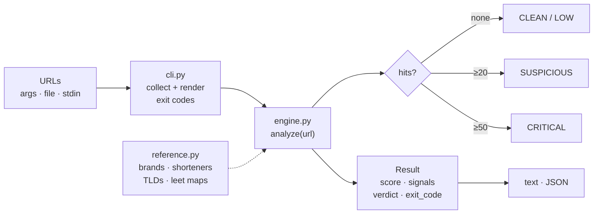

# phishverdict 🎣

**Offline phishing-URL triage CLI — score suspicious URLs before a human clicks or a bot fetches them.**

Zero runtime dependencies. No network calls. No telemetry. Python 3.9+ standard library only.

[](#run-the-tests)
[](requirements.txt)
[](pyproject.toml)
[](LICENSE)
[](#legal--ethical-use)

---

## Why

Phishing remains the #1 initial access vector, and AI-generated campaigns have made phishing URLs cheaper to produce and harder to eyeball. Modern security teams already have heavyweight answers for deep inspection (sandboxes, reputation feeds, VirusTotal keys) — but those all need network access, API keys, budget, or a browser plugin. Frequently what you need first is **30 seconds of offline triage on a pile of URLs**: the ones from user-reported emails, ticket queues, SIEM alerts, or the `href`s you found in scraped page content.

`phishverdict` gives every URL a weighted signal score and a verdict — **CLEAN / LOW / SUSPICIOUS / CRITICAL** — with the *reasons* printed next to it, entirely offline. It is the "should I escalate this?" filter that runs before the expensive tools.

```
A URL in           ┌──────────────────────────────┐        verdict out
──────────────────▶│  normalize & parse           │──────────────────
                    │  ├─ scheme guard (js/data/) │
                    │  ├─ host extraction        │      CLEAN
                    │  └─ registrable domain      │      LOW
                    └──────────────┬───────────────┘      SUSPICIOUS
                                   ▼                      CRITICAL
                    ┌──────────────────────────────┐
                    │  signal engine (11 checks)   │
                    │  brand · homoglyph · IP ·    │
                    │  shortener · TLD · userinfo  │
                    └──────────────┬───────────────┘
                                   ▼
                    ┌──────────────────────────────┐
                    │  weighted scoring            │   0–19  LOW
                    │  sum, capped at 100          │  20–49  SUSPICIOUS
                    │                              │  50+    CRITICAL
                    └──────────────────────────────┘
```

## Architecture



Module map:

| File | Responsibility |
|---|---|
| `src/phishverdict/cli.py` | argument parsing, file/stdin/arg collection, text & JSON rendering, exit codes |
| `src/phishverdict/engine.py` | pure `analyze(url) -> Result` — all 11 signal checks and weighted scoring |
| `src/phishverdict/reference.py` | curated data: brand list, official domains, URL shorteners, risky TLDs, login tokens, ccTLD second-level suffixes, leet-translations, Levenshtein with early exit |

Design rules:

- **Pure functions.** `analyze()` has no I/O, no state, no clock, no randomness — same URL in, same verdict out, which is what makes the test suite (42 tests) meaningful.
- **Zero dependencies.** `urllib.parse`, `ipaddress`, `codecs`, `dataclasses`, `argparse` — all stdlib, so it runs on a locked-down analyst VM with no pip.
- **Explain, don't accuse.** Every hit carries its weight, signal id, and the exact evidence (which token matched, what the punycode decodes to, what the registrable domain is). You escalate the *report*, not just the score.

## Installation

**Option A — run straight from the source tree**

```bash
git clone https://github.com/mehulpatel23b-pixel/phishverdict.git
cd phishverdict
PYTHONPATH=src python3 -m phishverdict examples/urls.txt
```

**Option B — install as a package**

```bash
cd phishverdict
pip install .          # installs the `phishverdict` entrypoint
phishverdict https://example.com/some-link
```

**No third-party requirements** — see [requirements.txt](requirements.txt) (it contains only a comment).

## Usage guide

Analyze URLs directly:

```bash
phishverdict "http://paypal.com.verify-login.xyz/webscr"
```

Feed a whole file (comments and blank lines allowed):

```bash
phishverdict examples/urls.txt
```

Pipe from anything — mail logs, SIEM exports, SIEM scripts:

```bash
grep -oE 'https?://[^ "]+' email_queue.log | phishverdict -
```

Machine-readable JSON for your playbook / SOAR glue:

```bash
phishverdict --json examples/urls.txt > report.json
```

Real output from `examples/urls.txt` (this is genuine captured output, not mockup):

```
URL      : http://paypal.com.verify-login.xyz/webscr?cmd=_login-run
host     : paypal.com.verify-login.xyz   (registrable: verify-login.xyz)
VERDICT  : CRITICAL 52
  [!] brand_impersonation (30) Brand token 'paypal': 'paypal' appears in the subdomain chain, but the registrable domain is 'verify-login.xyz' (official: paypal.com)
  [!] risky_tld (12) High-risk TLD .xyz: registrable domain is 'verify-login.xyz'
  [!] login_keyword (10) Login-themed hostname: tokens: login, verify
────────────────────────────────────────────────────────────────
URL      : http://paypa1-secure.com/webscr
host     : paypa1-secure.com   (registrable: paypa1-secure.com)
VERDICT  : SUSPICIOUS 45
  [!] brand_lookalike (35) Lookalike of 'paypal': registrable domain 'paypa1-secure.com' imitates a leet/typosquat of paypal.com
  [!] login_keyword (10) Login-themed hostname: tokens: secure
────────────────────────────────────────────────────────────────
URL      : http://xn--80ak6aa92e.com/appleid.verify/
VERDICT  : SUSPICIOUS 40
  [!] idn_homoglyph (40) Punycode/IDN host: decodes to 'аррӏе.com'
```

Full sample: [examples/sample_output.txt](examples/sample_output.txt).

### Exit codes (CI-friendly)

| Code | Meaning |
|---|---|
| `0` | no URL scored ≥ 20 (all CLEAN or LOW) |
| `1` | at least one SUSPICIOUS or CRITICAL — triage it |
| `2` | operational error (unreadable file, no input URLs) |
| `64` | usage error |

### The full signal catalog

| Signal | Weight | What it catches | Example |
|---|---|---|---|
| `dangerous_scheme` | 60 | `javascript:` / `data:` / `vbscript:` URLs that execute in a browser | `javascript:alert(document.cookie)` |
| `idn_homoglyph` | 40 | punycode/IDN lookalike hosts | `xn--80ak6aa92e.com` → `аррӏе.com` |
| `userinfo_trick` | 40 | `userinfo@` prefix that makes the real host look legit | `http://paypal@evil.tld/` |
| `ip_literal_host` | 35 | dotted, decimal, hex and octal IP hosts | `http://2130706433/`, `http://0x7f000001/` |
| `brand_lookalike` | 35 | leetsquat / typosquat of a known brand in the registrable domain | `g00gle.com`, `paypa1-secure.com` |
| `brand_impersonation` | 30 | brand token placed in the subdomain chain of someone else's domain | `paypal.com.verify-login.xyz` |
| `nested_url` | 25 | a second `://` hiding in the path — redirect/cloaking shape | `mail.example.com/r?u=http://evil.tld` |
| `url_shortener` | 15 | known shorteners hiding the final destination | `bit.ly/4aBc` |
| `risky_tld` | 12 | registrable domain on a high-abuse TLD | `free-gift.zip`, `verify-app.top` |
| `login_keyword` | 10 | login-themed whole tokens in the hostname | `secure-login-app.top` |
| `excessive_depth` | 8 | deep subdomain stacking (≥ 4 labels) | `a.b.verify.mail.login.example.com` |
| `hyphen_stuffing` | 8 | ≥ 4 hyphens in the host | `secure-my-account-now-verify.net` |
| `extreme_length` | 5 | URL longer than 200 chars | URL-shortener link stuffing |

Verdict bands: **CLEAN** 0 · **LOW** 1–19 · **SUSPICIOUS** 20–49 · **CRITICAL** 50+ (capped at 100).

Brand list, shorteners, and risky TLDs live in one readable file — [`reference.py`](src/phishverdict/reference.py). Extend it for your environment: add your own company brand, the shorteners your mail gateway actually sees, the TLDs your users get phished from.

## Security use cases

1. **Helpdesk / SOC first-pass triage** — paste the URLs from a user-reported phish; the printed reasons give the analyst their escalation justification in one copy-paste.
2. **Mail-queue batch screening** — extract links from a mail log export and triage hundreds per second, offline; anything ≥ SUSPICIOUS goes to the deep-dive sandbox, everything else auto-closes.
3. **SOAR / automation enrichment step** — `--json` output feeds a playbook: run the zero-cost offline verdict first, spend your VirusTotal / URLhaus quota only on flagged URLs.
4. **Web-scraping hygiene for agents** — point your scraper or LLM agent at a *derived* link list and filter out the credential-phishing honeypots before your bot ever fetches them.
5. **Security-awareness datasets** — build training corpora from archived phishes: mix real historical phishing URLs with your corporate legit set and validate that known-benign domains stay CLEAN (the `TestBenignCorpus` pattern).
6. **CI gate for content platforms** — in a wiki, CRM, or CMS deployment pipeline, fail the build if a new content bundle contains CRITICAL links.
7. **CTI research support** — quick reproducible labeling of URL datasets with explainable signals for regression-diffing how kits evolve month over month.

## How reliable is it? (honesty section)

- This is a **heuristic triage aid, not a verdict** — despite the name. It can be fooled by clean-looking phishing (small VPS IP on a reputable domain, fresh legit-looking wordmark) and it can occasionally raise LOW-noise on odd-but-real hostnames. Use it to prioritize, never to auto-punish users or auto-block in isolation.
- The curated lists (brands, shorteners, TLDs) are deliberately small and visible. Extending them is one plain-data file, no code.
- Registrable-domain parsing uses a sensible ccTLD suffix approximation (see `reference.registrable_domain`), not the full Public Suffix List — correct for every brand site and two-level ccTLD we tested, without shipping a PSL dump.
- Hosts on a brand's *official* registrable domain are trusted (e.g. `outlook.office.com` stays CLEAN); obviously a compromise of that domain is outside this tool's scope.
- No signal here proves malice. A `LOW` on a shortener is expected daily noise. The README's job is triage ordering: 60-point scheme XSS beats a 5-point long URL, and both are sane.

## Run the tests

```bash
PYTHONPATH=src python3 -m unittest discover -s tests
# Ran 42 tests ... OK
```

The suite covers every signal individually, the exact verdict thresholds, exit codes through the CLI layer (args, files, stdin, JSON), and a false-positive corpus of real-world benign sites (Google, BBC, GitHub, Python docs, banks) that must stay CLEAN.

## Legal & ethical use

`phishverdict` exists for **defensive, authorized analysis**: URLs you or your organization received, datasets you're licensed to research, content your systems ingest. It is *analysis* software — it adds no exploit capability — but do not use it to craft, select, or optimize phishing lures, and respect your jurisdiction's computer-misuse and privacy laws when processing URLs that contain personal data. MIT license; the authors owe you nothing, bodily or otherwise.

## License

[MIT](LICENSE) © 2026 Mehul Patel
